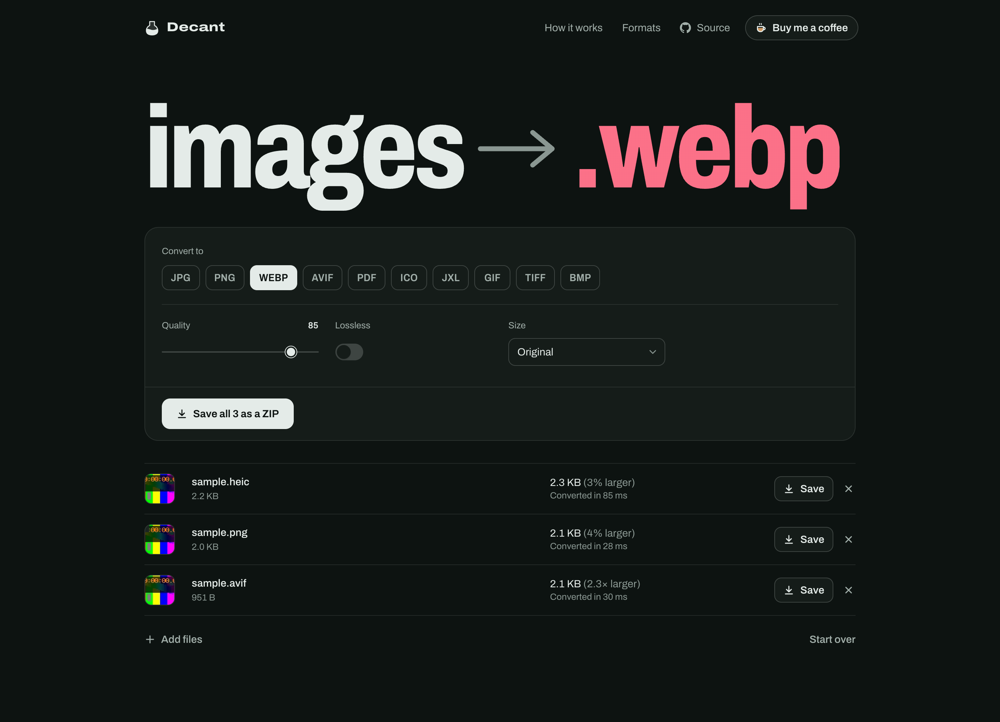
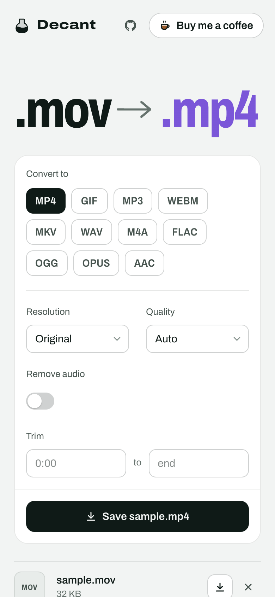
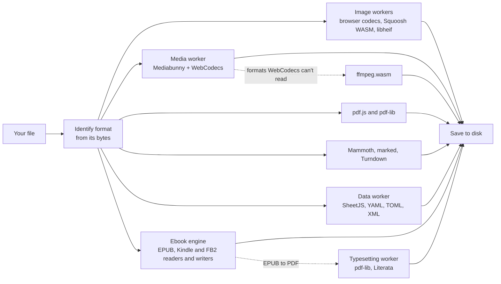

<div align="center">

# Decant

**Convert files in your browser. Nothing is uploaded.**

[**decant.dev**](https://decant.dev/) &ensp;|&ensp; [Buy me a coffee](https://buymeacoffee.com/joshuafitzmorris)

</div>



Online converters turn a ten-second job into a chore: upload your file to someone else's server, wait in a queue, dodge the ads, hit a size limit, make an account. Decant skips all of it. It converts images, audio, video, ebooks, documents and spreadsheets inside the browser tab, so your files never leave your device and most conversions finish in under a second.

- **No ads, no tracking.** No analytics, no cookies, no third-party requests and no account. The page's security policy stops it from talking to any other site.
- **No queue, no limits.** Nothing waits on a server, and the only size limit is what your device can hold.
- **Open source.** MIT licensed, so you can check every claim here against the code.
- **Works offline.** The page, and each converter once you've used it, stay in your browser's cache.

**How does it make money?** It doesn't. It's a static site with nothing to bill, so it stays free. If it saves you some hassle, [buy me a coffee](https://buymeacoffee.com/joshuafitzmorris) or star the repo.

## What it converts

| | Reads | Writes |
| --- | --- | --- |
| **Images** | HEIC, JPG, PNG, WebP, AVIF, JPEG XL, GIF, TIFF, BMP, ICO, SVG | JPG, PNG, WebP, AVIF, JPEG XL, GIF, TIFF, BMP, ICO, PDF |
| **Audio** | MP3, WAV, FLAC, M4A, AAC, OGG, Opus, AIFF, WMA | MP3, WAV, FLAC, M4A, AAC, OGG, Opus |
| **Video** | MP4, MOV, WebM, MKV, AVI, WMV, FLV, MPEG-TS, MPEG, 3GP | MP4, MOV, WebM, MKV, GIF, or any of the audio formats |
| **Documents** | PDF, Word (DOCX), Markdown, HTML, plain text | PDF pages as PNG, JPG or WebP; PDF text; Markdown, HTML and text from the rest; EPUB from all of them |
| **Ebooks** | EPUB, Kindle (MOBI, AZW3), FictionBook (FB2), comics (CBZ) | EPUB, MOBI, a typeset PDF, FB2, plain text, Markdown, HTML; comics as PDF and PDFs as CBZ |
| **Data** | CSV, TSV, XLSX, XLS, ODS, JSON, YAML, TOML, XML | XLSX, ODS, CSV, TSV, JSON, YAML, TOML, XML |

Animated GIFs also become MP4 or WebM. Each conversion has the settings people reach for: quality and size for images, resolution, quality and trimming for video, bitrate for audio, page resolution for PDFs, page size for books.

Ebooks convert in every direction. An EPUB becomes a PDF typeset like a paperback, with a cover, chapters on new pages, page numbers and bookmarks; Kindle MOBI and AZW3 books become EPUB with their text, pictures, cover and contents; EPUB becomes MOBI for older Kindles; Word, Markdown and PDF files become EPUBs split into chapters at their headings or bookmarks. Books with DRM can't be converted, and Decant says so instead of producing garbage.

Drop a mix of files and Decant groups them by kind, so twenty iPhone photos and a screenshot all become JPGs with one click. Files are identified by their contents, not their names: a HEIC photo saved as `.jpg` is still read as HEIC.

<p align="center"></p>

## How it works



- **Nothing loads until it's needed.** The first visit downloads under 100 KB of compressed JavaScript. Each engine (and its WebAssembly) is fetched the first time a file needs it, then cached by a service worker for offline use.
- **Video and audio use your hardware.** [Mediabunny](https://mediabunny.dev) drives the browser's WebCodecs encoders and decoders, which use the GPU's media engine. When only the container changes (MOV to MP4, MKV to MP4), streams are copied without re-encoding, which takes a fraction of a second even for large files.
- **Older formats still work.** Files WebCodecs can't read (AVI, WMV, FLV, AIFF, WMA, or unusual codecs) fall back to ffmpeg.wasm. Its 32 MB core downloads only the first time one of those files shows up.
- **Images use the fastest decoder available.** The browser's own codecs come first; Squoosh's WebAssembly builds of MozJPEG, libwebp, libavif, libjxl and OxiPNG fill the gaps, and libheif handles HEIC outside Safari.
- **Heavy work stays off the main thread.** Image, media and data conversions run in Web Workers, several images at a time, and cancelling a job terminates its worker immediately.
- **Ebooks share one model.** Every reader (EPUB, MOBI and AZW3 through [foliate-js](https://github.com/johnfactotum/foliate-js), FB2, Word, Markdown, PDF) produces the same simple book, and every writer (EPUB 3, MOBI, FB2, PDF, text) takes it, so any source reaches any target. Publisher CSS is folded into plain italics, bold and alignment on the way in, since MOBI and FB2 can't use stylesheets.
- **Data keeps its meaning.** CSV to JSON keeps dates as written and leading zeros intact. Excel dates aren't shifted into another time zone. Word tables become proper Markdown tables.

### Privacy you can check

The page ships with a [Content-Security-Policy](scripts/vite-html.ts) whose `connect-src` allows only the page's own origin, so the browser itself refuses to send data anywhere else. The end-to-end suite includes a test that tries to `POST` to another site from the page and confirms it fails. There are no analytics, cookies or third-party requests of any kind, and the fonts and WebAssembly are self-hosted.

Decant is served as static files by GitHub Pages. Like any web host, it sees the request for the page itself; your files are never part of any request.

## Speed

Measured in Chrome on an Apple Silicon Mac:

| Job | Time |
| --- | --- |
| 12 MP HEIC photo → JPG | 0.45 s |
| 12 MP JPG → WebP | 1.1 s |
| 117 MB 1080p MOV → MP4 (stream copy) | 0.2 s |
| 60-second 1080p video → MP3 | 0.6 s |
| 10-second 4K HEVC video → 1080p H.264 MP4 | 1.3 s |
| 60-page PDF → JPG pages at 150 dpi | 11 s |
| 100,000-row CSV → XLSX | 2.4 s |

The page itself scores 99 for performance and 100 for accessibility, best practices and SEO in Lighthouse's mobile audit, with no layout shift and no main-thread blocking.

## Development

```sh
npm install
npm run dev        # http://localhost:5173
npm test           # unit tests (Vitest)
npm run test:e2e   # real conversions in Chrome and WebKit (Playwright)
npm run build      # production build in dist/

# Run the browser suite against the deployed site instead of a local build
E2E_BASE_URL=https://decant.dev/ npm run test:e2e
```

The browser suite runs in Google Chrome rather than bundled Chromium, because WebCodecs relies on Chrome's H.264 and AAC support, and in WebKit, Safari's engine (install Playwright's build once with `npx playwright install webkit`). Every push to `main` runs lint, type checks and both test suites, with WebKit on macOS so it uses the same media frameworks as Safari, then deploys to GitHub Pages.

```
src/
  app/        interface (React)
  core/       format catalogue, content sniffing, routes, options, naming
  engines/    one folder per engine, with its worker
    image/    browser codecs, Squoosh WebAssembly, libheif, UTIF
    media/    Mediabunny worker and the ffmpeg.wasm fallback
    pdf/      pdf.js rendering and text, pdf-lib for images to PDF
    docs/     Word, Markdown, HTML and text
    ebook/    EPUB, Kindle, FB2 and comic readers and writers; PDF typesetting
    data/     SheetJS and structured data
  lib/        worker pool
  state/      job store and scheduler
tests/
  unit/       Vitest
  e2e/        Playwright
  fixtures/   one small sample per readable format (scripts/make-fixtures.mjs, scripts/make-ebook-fixtures.mjs)
```

## Limits

- The browser tests run in Chrome and in WebKit, Safari's engine. Firefox isn't covered yet: Decant sticks to standard APIs that current Firefox also implements, but no automated test checks it there. When a browser lacks a codec, the conversion falls back to the slower ffmpeg.wasm path; in Safari that happens for FLAC, which WebKit's own decoder can't read.
- On iPhone and iPad, the photo picker hands websites a JPG copy of HEIC photos. To convert the original, tap ⋯ in the picker, then Options, and set Format to Current. Picking from Files always gives the original.
- Layout-heavy conversions such as Word to PDF aren't offered; doing them faithfully needs a full office suite.
- Ebooks protected with DRM (most Kindle Store and Adobe-protected books) can't be converted. PDF to EPUB rebuilds the text but leaves pictures out, and scanned PDFs have no text to rebuild. AZW3 is read but not written; MOBI is written for older Kindles, and newer ones take EPUB through Send to Kindle.
- Speed depends on your device and browser. Video re-encoding is fastest where the browser has hardware encoders; the ffmpeg.wasm fallback is much slower than native ffmpeg.
- Very large files are bound by memory. Video outputs from inputs over 512 MB are written to the browser's private file system instead of RAM.

## Credits

Decant is a thin layer over excellent open-source work:
[Mediabunny](https://github.com/Vanilagy/mediabunny) (MPL-2.0),
[ffmpeg.wasm](https://github.com/ffmpegwasm/ffmpeg.wasm) (MIT; the ffmpeg core is GPL-2.0-or-later and is served unmodified from `vendor/`),
[jSquash](https://github.com/jamsinclair/jSquash) and the Squoosh codecs (Apache-2.0),
[libheif-js](https://github.com/catdad-experiments/libheif-js) (LGPL-3.0),
[pdf.js](https://github.com/mozilla/pdf.js) (Apache-2.0),
[pdf-lib](https://github.com/Hopding/pdf-lib) and [fontkit](https://github.com/Hopding/fontkit) (MIT),
[foliate-js](https://github.com/johnfactotum/foliate-js) (MIT; its MOBI/KF8 reader is vendored unmodified),
[SheetJS](https://sheetjs.com) (Apache-2.0),
[Mammoth](https://github.com/mwilliamson/mammoth.js) (BSD-2-Clause),
[marked](https://github.com/markedjs/marked) and [Turndown](https://github.com/mixmark-io/turndown) (MIT),
[yaml](https://github.com/eemeli/yaml) (ISC), [smol-toml](https://github.com/squirrelchat/smol-toml) (BSD-3-Clause),
[fast-xml-parser](https://github.com/NaturalIntelligence/fast-xml-parser), [fflate](https://github.com/101arrowz/fflate), [gifenc](https://github.com/mattdesl/gifenc) and [UTIF.js](https://github.com/photopea/UTIF.js) (MIT),
the [Archivo](https://github.com/Omnibus-Type/Archivo) typeface and the [Literata](https://github.com/googlefonts/literata) book face (OFL-1.1).

## License

[MIT](LICENSE)
